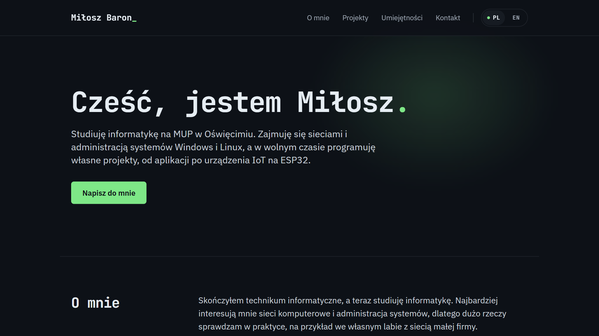

# Portfolio - Miłosz Baron

Moja strona-wizytówka: projekty, umiejętności, wykształcenie i kontakt.

**[miloszekxk.github.io](https://miloszekxk.github.io)** · [wersja angielska](https://miloszekxk.github.io/en/)

## Technologie

Astro, Tailwind CSS, TypeScript. Hosting na GitHub Pages z automatycznym wdrożeniem przez GitHub Actions.

## Co tu jest

- Dwie wersje językowe (PL i EN) z poprawnym SEO: hreflang, sitemapa, dane strukturalne
- Dostępność zgodna z WCAG 2.2 AA: obsługa klawiaturą, czytniki ekranu, `prefers-reduced-motion`
- Lighthouse 99-100 we wszystkich kategoriach
- Responsywny układ od 320 px, treść widoczna także bez JavaScriptu

## Edycja treści

| Co | Gdzie |
| --- | --- |
| Teksty sekcji (PL i EN) | `src/i18n/ui.ts` |
| Projekty, umiejętności, wykształcenie, certyfikaty | `src/data/projects.ts` |
| E-mail, GitHub, LinkedIn | `src/data/site.ts` |

Przycisk CV pojawia się sam po dodaniu pliku `public/cv.pdf`.
